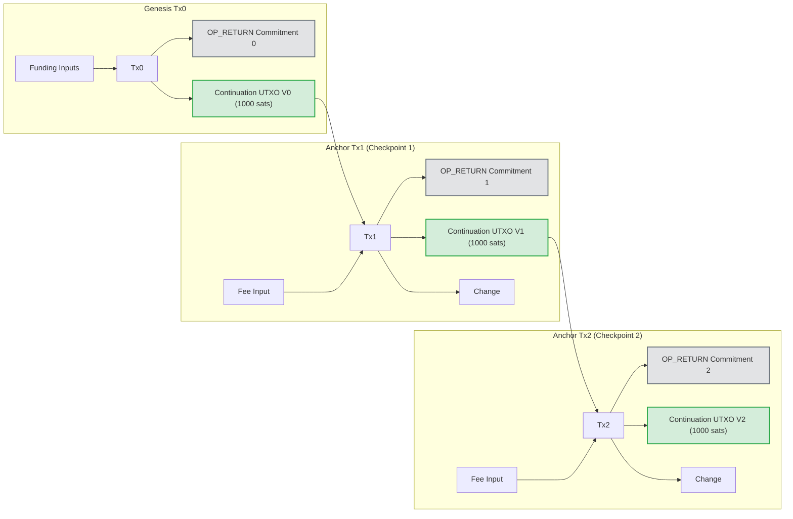

# Plan de Implementación — Issue #98
## Catena-Style OP_RETURN Chain for Single-History Property

> **Repositorio**: `satspath/satspath`  
> **Issue**: [#98 — [IMPORTANT] I9: Catena-style OP_RETURN chain for single-history property](https://github.com/satspath/satspath/issues/98)  
> **Entrega**: Pull Request apuntando a `main` en `satspath/satspath`, branch `feat/issue-98-catena-anchor`  
> **Referencias**:
> - `crates/satspath-core/src/transparency/anchor.rs`
> - `docs/key_transparency.md` (§ Regtest anchoring)
> - Paper: *"Catena: Efficient Non-equivocation via Bitcoin"* (Tomescu & Devadas, IEEE S&P 2017)

---

## 1. Contexto y Problema

### Limitación Actual de los Anclajes Independientes
Actualmente, SatsPath implementa el anclaje de checkpoints en Bitcoin mediante [`RegtestAnchorClient`](../crates/satspath-core/src/transparency/anchor.rs) utilizando transacciones `OP_RETURN` individuales:

```text
Tx_A: [Wallet UTXO] ---> [OP_RETURN Commitment_A] + [Change]
Tx_B: [Wallet UTXO] ---> [OP_RETURN Commitment_B] + [Change]
```

En este esquema:
1. **Falta de encadenamiento causal en Bitcoin**: Cada transacción de anclaje gasta UTXOs arbitrarios provistos por la billetera y no está vinculada criptográficamente a la transacción de anclaje anterior.
2. **Vulnerabilidad a Vistas Divididas (Split-View / Equivocation)**: Un operador malicioso o comprometido podría generar dos series paralelas de checkpoints ($A_1, A_2, \dots$ y $B_1, B_2, \dots$) y anclarlas en transacciones separadas de Bitcoin.
3. **Sobrecarga de Auditoría**: Para que un auditor o cliente ligero compruebe que no existen anclajes contradictorios, tendría que escanear y procesar **todos los bloques de Bitcoin**, ya que cualquier transacción en la red podría ser un anclaje alternativo del operador.

### La Solución Catena (Tomescu & Devadas, 2017)
Catena transforma a Bitcoin en un **servicio de consenso de no-equivocación de solo-lectura**:
- El registro se inicia con una **transacción génesis** conocida públicamente ($Tx_0$) que crea un UTXO de continuación $V_0$.
- Cada anclaje posterior $Tx_i$ ($i \ge 1$) **debe gastar obligatoriamente** el UTXO de continuación $V_{i-1}$ de la transacción $Tx_{i-1}$.
- Dado que las reglas de consenso de Bitcoin prohíben estrictamente el doble gasto de cualquier UTXO, **es matemáticamente imposible para el operador generar dos anclajes válidos a la misma altura sin provocar un doble gasto que los mineros y nodos de Bitcoin rechazarán**.

---

## 2. Arquitectura del Protocolo Catena en SatsPath



### Invariantes Criptográficas y de Consenso

1. **Génesis Fijo y Anunciado**: El identificador de la cadena Catena está unívocamente determinado por `GenesisOutpoint = (genesis_txid, genesis_vout)`.
2. **Linealidad Estricta**: Para todo $i \ge 1$, el input de continuación de $Tx_i$ debe referenciar exactamente el outpoint `(txid_{i-1}, vout_continuation_{i-1})`.
3. **Compromiso Inmutable**: Cada $Tx_i$ incluye una salida `OP_RETURN` con el prefijo de dominio `SatsPathCatenaAnchorV1` seguido del hash del checkpoint y el índice secuencial.
4. **Conservación de Capital**: El valor del UTXO de continuación (e.g. 1,000 satoshis) se transfiere de $Tx_{i-1}$ a $Tx_i$, deduciendo únicamente las tarifas de red normales a través de un input de tarifa complementario.

---

## 3. Especificación de Tipos y Estructuras (`satspath-core`)

En `crates/satspath-core/src/transparency/catena.rs`:

```rust
use serde::{Deserialize, Serialize};
use crate::BitcoinNetwork;

/// Parámetros del punto de partida inmutable de la cadena Catena.
#[derive(Debug, Clone, Serialize, Deserialize, PartialEq, Eq)]
pub struct CatenaGenesis {
    pub network: BitcoinNetwork,
    pub txid: String,
    pub vout: u32,
    pub operator_pubkey: String,
    pub created_at: i64,
}

/// Registro de un eslabón confirmado en la cadena Catena.
#[derive(Debug, Clone, Serialize, Deserialize, PartialEq, Eq)]
pub struct CatenaAnchor {
    pub network: BitcoinNetwork,
    pub chain_index: u64,
    pub txid: String,
    pub prev_txid: String,
    pub prev_vout: u32,
    pub continuation_vout: u32,
    pub checkpoint_hash: String,
    pub commitment: String,
    pub block_hash: Option<String>,
    pub block_height: Option<u64>,
    pub confirmations: u32,
    pub verified: bool,
}

/// Prueba de inclusión y trazabilidad de una secuencia Catena desde el génesis.
#[derive(Debug, Clone, Serialize, Deserialize, PartialEq, Eq)]
pub struct CatenaChainProof {
    pub genesis: CatenaGenesis,
    pub anchors: Vec<CatenaAnchor>,
    pub latest_checkpoint_hash: String,
}
```

### Formato del Compromiso `OP_RETURN` (V2)

```rust
pub fn catena_commitment(checkpoint_hash: &str, chain_index: u64) -> Result<String, hex::FromHexError> {
    let mut h = sha2::Sha256::new();
    h.update(b"SatsPathCatenaAnchorV1");
    h.update(&chain_index.to_be_bytes());
    h.update(hex::decode(checkpoint_hash)?);
    Ok(hex::encode(h.finalize()))
}
```

---

## 4. Algoritmos de Construcción y Verificación

### 4.1 Construcción del Siguiente Anclaje (`anchor_next_checkpoint`)

Cuando el daemon emite un nuevo checkpoint en el log de transparencia:
1. **Consulta del Último Estado**: Recupera el último `CatenaAnchor` registrado en la base de datos (o el `CatenaGenesis` si es el primer anclaje).
2. **Selección del UTXO de Continuación**: Especifica el input 0 como `(prev_txid, continuation_vout)`.
3. **Construcción de Salidas**:
   - Output 0: `OP_RETURN <catena_commitment>`
   - Output 1: `continuation_address` (P2TR o P2WPKH del operador) con valor de 1,000 satoshis.
4. **Financiación y Firma**:
   - Bitcoin Core agrega inputs adicionales para cubrir el fee mediante `fundrawtransaction`.
   - Se firma el input de continuación usando la clave del operador y los inputs de tarifa usando la billetera de Bitcoin Core.
5. **Transmisión y Confirmación**: Se emite la transacción mediante `sendrawtransaction` y se registra en SQLite.

### 4.2 Verificación de Cadena Hacia Atrás (Backward Verification)

Un verificador o cliente que recibe un `CatenaAnchor` para un checkpoint realiza:
1. Comprueba que el `OP_RETURN` contiene el compromiso válido del checkpoint.
2. Obtiene la transacción $Tx_i$ desde su nodo Bitcoin o API RPC.
3. Verifica que el input 0 gasta $(Tx_{i-1}, vout_{cont})$.
4. Itera recursivamente hasta alcanzar $(genesis\_txid, genesis\_vout)$.
5. Valida que ningún bloque intermedio haya experimentado bifurcaciones (confirmaciones mínimas $> k$).

### 4.3 Detección Irrefutable de Equivocación (Split-View Detection)

Si un observador $A$ tiene un anclaje con hash de checkpoint $H_A$ y el observador $B$ tiene $H_B$ para el mismo `chain_index`, o si una transacción alternativa gasta el mismo $(Tx_{i-1}, vout_{cont})$ con diferente compromiso:
- Se genera un `CatenaEquivocationProof` conteniendo ambas transacciones firmadas de Bitcoin.
- Debido a la regla de consenso de Bitcoin, una de ellas quedó fuera de la cadena principal o ambas demuestran intento de doble gasto, exponiendo la mala fe del operador sin ambigüedades.

---

## 5. Análisis de Costos y Política de Anclaje para Mainnet

### Presupuesto de Bytes y Satoshis
| Parámetro | OP_RETURN Tradicional | Catena Chained Anchor |
|-----------|------------------------|-----------------------|
| **Inputs** | 1 Taproot (~57.5 vB) | 2 Taproot (Continuation + Fee, ~115 vB) |
| **Outputs** | OP_RETURN (43 vB) + Change (43 vB) | OP_RETURN (43 vB) + Cont UTXO (43 vB) + Change (43 vB) |
| **Tamaño Total** | ~110 – 140 vbytes | ~180 – 210 vbytes |
| **Capital Bloqueado** | 0 sats | 1,000 sats (fijo, recirculado perpetuamente) |
| **Costo por Anclaje (a 15 sat/vB)** | ~1,800 sats (~$1.20 USD) | ~3,000 sats (~$2.00 USD) |

### Política de Anclaje Recomendada (Mainnet Budgeting)
1. **Anclaje por Épocas (Periodic Anchoring)**:
   - Anclar 1 vez cada 24 horas (o cada 144 bloques de Bitcoin).
   - Costo mensual estimado: $30 \times 3,000 \text{ sats} = 90,000 \text{ sats}$ (~$60 USD/mes), perfectamente viable para un operador de infraestructura.
2. **Anclaje Inmediato por Eventos Críticos (Event-Driven Anchoring)**:
   - Se fuerza un anclaje inmediato si ocurre una rotación de clave de identidad ([`RotateKey`](../crates/satspath-core/src/transparency/mod.rs)), una revocación de método de pago, o una recuperación de cuenta ([`RecoverKey`](../crates/satspath-core/src/recovery.rs)).
3. **Entorno Regtest / Testnet4**:
   - En regtest, anclar en cada bloque de prueba o checkpoint para validar el pipeline CI continuo.

---

## 6. Fases de Implementación y Tareas

### Fase 1: Núcleo Criptográfico y Tipos (`satspath-core`)
- [ ] Crear `crates/satspath-core/src/transparency/catena.rs`:
  - Definición de `CatenaGenesis`, `CatenaAnchor`, `CatenaChainProof`.
  - Función de compromiso de dominio `catena_commitment(checkpoint_hash, chain_index)`.
  - Validador local de encadenamiento de transacciones `verify_catena_link(...)`.
- [ ] Exponer el módulo en `crates/satspath-core/src/transparency/mod.rs` y `crates/satspath-core/src/lib.rs`.

### Fase 2: Cliente RPC y Gestor de Cadena Bitcoin Core
- [ ] Extender `RegtestAnchorClient` o crear `CatenaAnchorClient` en `crates/satspath-core/src/transparency/anchor.rs`:
  - `initialize_genesis()`: crea y financia la transacción génesis con el output inicial de continuación.
  - `anchor_next_checkpoint()`: arma la transacción con gasto del UTXO de continuación previo y generación del nuevo.
  - `trace_chain()`: consulta la secuencia de transacciones hacia atrás hasta el génesis.

### Fase 3: Persistencia Transaccional en SQLite (`satspathd`)
- [ ] Añadir migración SQLite (v11) en `satspath-transparency-v1.sqlite3`:
  - Tabla `catena_genesis (network, txid, vout, operator_pubkey, created_at)`.
  - Tabla `catena_anchors (chain_index PRIMARY KEY, txid, prev_txid, prev_vout, continuation_vout, checkpoint_hash, commitment, block_height, block_hash, confirmations, verified, created_at)`.
- [ ] Integrar el commit de anclaje dentro de la transacción SQLite `BEGIN IMMEDIATE` para mantener consistencia con los checkpoints.

### Fase 4: Endpoints del Daemon y CLI de Auditoría
- [ ] Endpoint `GET /v1/transparency/catena/proof`: devuelve la prueba de la cadena desde el génesis hasta el último checkpoint.
- [ ] Endpoint `GET /v1/transparency/catena/latest`: devuelve el estado actual del anclaje y el UTXO de continuación activo.
- [ ] Subcomando CLI: `satspath transparency catena-verify --genesis-txid <TXID> --genesis-vout <VOUT>` para verificación independiente sin confiar en el daemon.

### Fase 5: Pruebas Automatizadas y Validación
- [ ] Pruebas unitarias en `catena.rs` simulando secuencias válidas y ataques de bifurcación/doble gasto.
- [ ] Prueba de integración Regtest con Bitcoin Core (`tests/catena_regtest.rs`):
  - Creación de génesis.
  - Creación secuencial de 5 anclajes encadenados.
  - Intento de bifurcación (generar dos anclajes gastando el mismo output) verificando el rechazo por doble gasto.
- [ ] Actualización de documentación en `docs/key_transparency.md`.

---

## 7. Criterios de Aceptación (Definition of Done)
1. **Unicidad Probada**: La prueba de integración demuestra que no es posible generar dos anclajes aceptados por Bitcoin Core para el mismo eslabón de la cadena sin un doble gasto detectado.
2. **Compatibilidad Descendente**: Si no se configura `SATSPATH_BITCOIN_NETWORK=regtest`, el daemon continúa operando normalmente en modo local o witness-only sin fallos.
3. **Auditoría Completa**: Un cliente externo puede verificar la cadena completa de anclajes desde el génesis con una sola llamada RPC a Bitcoin Core o servicio electrum.
4. **CI en Verde**: Todos los tests de workspace, linter clippy, formateo y análisis de CodeRabbit pasan sin advertencias.
