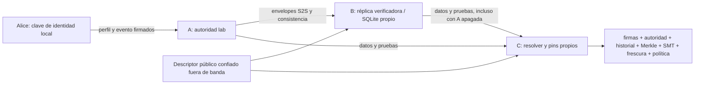

# Red de resolución: primer slice federado verificable

Rama `feat/public-resolution-network`, sobre el trabajo local sin commit de
`codex/secure-lab-identity`. No se sobrescribieron los archivos previamente staged.
No hay merge, publicación de paquetes ni despliegue público.

**Base de revisión de la PR:** los resultados corresponden al checkout
`cc0f109` (`feat/satspathd-hyperswarm-bridge`), no al `main` actual `82fc4bb`.
Al preparar la PR se comprobó que main tiene 41 commits posteriores, incluyendo
trabajo de ownership, gossip y documentación ausente en este checkout. La PR se
abre como borrador contra la base histórica para aislar el slice probado. Antes
de integrarla en main hay que reconciliar los componentes existentes allí y
repetir las pruebas sobre esa base; no se afirma compatibilidad con main actual.

## Auditoría breve

Se inspeccionaron core, daemon, CLI, S2S v2, descriptor, perfiles, log Merkle,
SMT, SQLite, registro, witnesses, replicación y Hyperswarm. Se relecieron los
documentos `docs/s2s/` y el informe [de identidad](secure-identity-lab.md).
`ROADMAP.md`, `docs/README.md` y `docs/API_REFERENCE.md` están ausentes en este
checkout. No se crearon documentos sustitutos pretendiendo que ya existían.

| Área | Estado antes de esta etapa | Implementación/reutilización |
| --- | --- | --- |
| Identidad y namespace | Registro lab con challenge/posesión y commit atómico de la etapa anterior | Reutilizado; nuevos updates owner-signed, sin tokens mock |
| Merkle/SMT | Firmas, inclusión, consistencia, replay, mapa y rotación existentes | Verificados por B y por C; sin otra blockchain |
| Replicación | Helpers de selección, salud y rollback; faltaba ingesta/servicio conectado | Caché S2S SQLite, pull periódico, commit de vista/pin y servicio read-only |
| Endpoint selection | Ignoraba el allowlist y admitía primaries obsoletos | Sólo endpoints autorizados y edad válida, incluidos primaries |
| Witnesses | Criptografía, pin stores y tests de quorum existentes | Reutilizados; claves deduplicadas por identidad criptográfica, no por texto |
| Gossip | Sin red de gossip integrada en daemon/resolver de este checkout | No se afirma prevención global de split view |
| Discovery DNSSEC/HTTPS | Parser/spec y resolvers parciales; comandos CLI con placeholders | Bootstrap explícito firmado para lab, HTTPS soportado; discovery autónomo bloqueado |
| SQLite | Store transaccional con WAL y reconstrucción de log/mapa | Tablas de réplica en el mismo mecanismo; no se requiere PostgreSQL |
| Hyperswarm | SDK/bridge opt-in, transporte de perfiles candidatos | Experimento separado con dos peers; Rust valida contra evidencia S2S |

Se consultaron [#206](https://github.com/satspath/satspath/issues/206),
[#203](https://github.com/satspath/satspath/issues/203) y las referencias ya
auditadas #201, #49, #51, #52, #53 y #54. La
[PR #215](https://github.com/satspath/satspath/pull/215) contiene onboarding HTTPS
distinto, ausente de esta rama y pendiente de reconciliación; no se duplicó su
verificador ni se hizo merge de esa PR.

## Arquitectura y confianza



La asignación inicial pertenece a la autoridad del namespace; el bearer del
operador lab permite admitir el nombre, pero nunca sustituye las firmas de
Alice. Alice firma actualizaciones con secuencia/predecessor exactos. El endpoint
`POST /v1/lab/profiles/mutate` también acepta rotación dual y revocación según las
primitivas existentes; no admite Register ni RecoverKey. Cambiar un destino
mediante el cliente invalida los proofs previos de propiedad de métodos.
Modificarlo sin volver a firmar rompe la firma.

Perfil y evento deben vincular **el mismo alias/hash**, además de clave, contenido
y secuencia: se reforzó esta comprobación en `prepare_append` y
`verify_event_profile`. Dos firmas válidas no justifican mezclar nombres.

El descriptor firmado enumera los orígenes A/B. Se exporta en A verificando la
clave contra el operador local y se transfiere como **JSON público** a B y C por
un canal autenticado. No se distribuyen claves de A ni el token administrativo.
Un descriptor autodeclarado desde un peer cualquiera no constituye bootstrap.
El laboratorio reúne autoridad de namespace y operador en una clave; separar
esas funciones y su rotación es un requisito de producción.

B recibe su propio home y arranca con `--replica-descriptor`. Rechaza un home con
wallet, identidad, macaroon o clave de operador existente, y no genera esos
materiales. Su router permite lecturas S2S y rechaza todas las mutaciones de
identidad, incluso si se envía el token de A. POST `/v2/resolve` es lectura.

## Sincronización, durabilidad y fallos

B consulta exclusivamente el primer origen (A), con redirects y proxies
deshabilitados, timeout de cinco segundos y respuesta máxima de 64 KiB. El
descriptor sólo permite HTTPS, o HTTP en loopback para laboratorio.

Cada pull verifica el descriptor/política confiable, perfil, historial autorizado,
inclusión, checkpoint, mapa de estado y consistencia contra el pin durable de B.
Todas las identidades configuradas deben pertenecer al mismo checkpoint; una
carrera de lectura que mezcle snapshots se rechaza y se vuelve a intentar en el
siguiente ciclo, sin avance parcial.

Una transacción `BEGIN IMMEDIATE` confirma envelopes, proofs de consistencia y pin
global del log. Cada lectura usa una vista SQLite coherente y vuelve a verificar
el contenido contra ese pin. B nunca reconstruye evidencia firmando con una clave
propia. El log/SMT de A sigue siendo el compromiso autenticado; el cache de B
contiene pruebas de esos compromisos, no un consenso nuevo.

Una avería de red conserva el cache válido. Una respuesta inválida del upstream
activa una cuarentena durable, que no se limpia por recibir luego un replay
válido. Investigar y conservar la base antes de cualquier recuperación manual;
no hay un endpoint remoto que resetee confianza o libere esa cuarentena.
Esta versión trata también la evidencia caducada recibida de A de forma
conservadora; la recuperación automática diferenciada por causa queda pendiente.

Frescura explícita: checkpoint de hasta **300 segundos**, con máximo skew futuro
de 300 segundos, y perfil y ambos descriptores todavía vigentes. Releer el cache
no renueva timestamps firmados. Una réplica desactualizada falla, no cambia sus
fechas. Los checkpoints del demo no se renuevan por latidos: tras cinco minutos
sin avances de A la resolución puede dejar de estar disponible incluso si A
está encendida. Eso es una limitación deliberada de este slice.

C consulta sólo los orígenes del descriptor confiable. Una indisponibilidad
permite probar el siguiente; datos/firma/proof inválidos son fallo terminal,
sin votar entre peers ni fallback a una política más débil. C guarda su propio
checkpoint después de verificar. Si todos los endpoints fallan, no inventa un
resultado ni convierte un perfil local obsoleto en resolución válida.

Un checkpoint de igual tamaño debe mantener su hash completo en esta política
lab, no sólo el root del log. Se rechazan cambios de map root/checkpoint en la
misma altura. No se implementó renovación del checkpoint en la misma altura.

### Límite de la réplica

Es un mirror de envelopes para **1..32 alias configurados**, no una réplica completa
del archivo histórico de todos los namespaces. El lote reemplaza la vista anterior
por una vista coherente. Los proofs de consistencia cacheados cubren los avances
que B observó. Si C pide un intervalo que B nunca obtuvo y A está caída, B falla
cerrada; no inventa el proof. El protocolo de backfill/retención completo sigue
pendiente. Falta cuota/retención de proofs a largo plazo.

Un 503 por alias no configurado no demuestra no-existencia. No hay negative
caching autenticado en este mirror. Revocación observada o evidencia invalidada
impiden servir el perfil anterior; la representación de tombstones remotos está
pendiente. No existe promoción automática de B a autoridad.

## Quorum, Sybil y readiness

Los endpoints desconocidos no participan en selección. El test usa 1.000 nodos
simulados que declaran salud/prioridad/tamaño superiores y no adquieren autoridad.
Para witnesses se exige pertenencia al conjunto autorizado y firma sobre el
checkpoint exacto. Mil claves no autorizadas y mil copias del mismo witness no
satisfacen 2-of-3. Se normalizan las claves antes de deduplicar; distintas formas
textuales de una clave siguen contando una vez. La identidad se normaliza como
BIP340 x-only: P y -P tampoco cuentan como dos witnesses. Core y el servicio
witness reutilizan el mismo helper de normalización.

Los tests ejercitan pérdida de un witness con 2-of-3 todavía válido, pérdida de
quorum y ausencia total de evidencia. No equivalen a desplegar tres operadores
independientes. El prototipo `WitnessService` necesita aún endurecimiento operativo
(autoridad/operador esperado, concurrencia, timestamps y bloqueo persistente tras
equivocación), integración de recolección y gossip antes de certificarse.

La demo usa quorum **cero**. C lo indica como `not_deployed` y
`degraded_unwitnessed_lab`; `production_payment_ready` permanece falso.
`/health` sólo certifica liveness; `/v2/health` en B comprueba cache verificable y
fresco. La autoridad ya no presenta un log abierto como quorum healthy ni inventa
una réplica. Readiness de producción sigue siendo falsa.

No se afirma resistencia Sybil global: se ha demostrado rechazo local de autoridad
no autorizada. Un operador confiado malicioso aún puede bifurcar la primera vista
de clientes nuevos sin witnesses/gossip. Los pins detectan rollback/forks observados,
no garantizan disponibilidad ni consistencia global.

## Ejecutar la demo

Prerequisitos: Rust 1.99/Cargo, compilador nativo y PowerShell 7. Desde la raíz:

```powershell
pwsh -NoProfile -File examples/secure-lab-smoke.ps1 -Federation
```

Compila daemon/cliente, registra Alice, inicia B con DB propia, hace que C guarde
un pin, actualiza el destino mediante firma de Alice, espera que B verifique el
avance, apaga A y exige que C verifique secuencia 1 y checkpoint 2 desde B.
Reinicia B con A apagada, comprueba que B no creó claves y exige fallo cuando
también se apaga B. Usa directorios temporales nuevos y sólo detiene sus procesos.
Los artefactos contienen claves **sintéticas privadas**: no publicar el directorio.

### Contenedores separados

Con Docker Desktop/Engine disponible:

```powershell
pwsh -NoProfile -File examples/public-resolution-containers.ps1
```

La imagen lab compila el mismo código y lockfile local. Si un checkout limpio no
contiene Cargo.lock (actualmente ignorado), el build genera uno antes de usar
`--locked`; eso no fija dependencias para un release. A, B y C usan contenedores
y volúmenes separados. El bootstrap se ejecuta dentro de A para exportar el
descriptor; B y C reciben únicamente el volumen público de descriptor.
La red loopback se comparte explícitamente entre estos contenedores para cumplir
la política HTTP de laboratorio; no es una prueba de TLS entre redes distintas.
No publica puertos en el host. El script elimina sólo los contenedores de su
proyecto generado y conserva volúmenes para auditoría; no borra datos existentes.
Los tags de imagen/paquetes del lab no son una cadena reproducible de release
auditada. La política del Cargo.lock de aplicación y los digests de release siguen
siendo trabajo de empaquetado (#203).

### Ubuntu: dos máquinas con HTTPS real

Obtener certificados WebPKI válidos para los nombres reales de los operadores;
no se crea un bypass TLS. Sustituir estos orígenes de ejemplo por dominios
controlados y configurados por los operadores:

```bash
cargo build -p satspathd --bin satspathd
cargo build -p satspath-core --example lab_client
umask 077
export SATSPATH_ENABLE_LAB_REGISTRATION=1
export SATSPATH_AUTHORITY_URL=https://a.your-lab.example
export SATSPATH_REPLICA_URLS='["https://b.your-lab.example"]'
export SATSPATHD_AUTH_TOKEN="$(openssl rand -hex 32)"
target/debug/satspathd --no-open --network regtest --home ./lab-a \
  --bind 0.0.0.0:9737 --tls-cert ./a-fullchain.pem --tls-key ./a-key.pem \
  --require-tls-or-proxy
```

En A, en otro terminal con el token del operador:

```bash
target/debug/examples/lab_client bootstrap ./lab-a https://a.your-lab.example ./descriptor.json
target/debug/examples/lab_client register ./descriptor.json ./alice alice@lab.satspath.test alice@example.com
```

Transferir el descriptor público por canal autenticado a B/C. Si se usa el puerto
9737 público directamente, incluirlo en ambos orígenes; con los orígenes del
ejemplo el reverse proxy debe terminar/reenviar HTTPS en 443 según configuración.
En B (home distinto, sin token ni claves de A):

```bash
unset SATSPATHD_AUTH_TOKEN SATSPATH_REPLICA_URLS
export SATSPATH_ENABLE_LAB_REGISTRATION=1
export SATSPATH_AUTHORITY_URL=https://b.your-lab.example
target/debug/satspathd --no-open --network regtest --home ./lab-b \
  --replica-descriptor ./descriptor.json --replica-alias alice@lab.satspath.test \
  --replica-sync-seconds 1 --bind 0.0.0.0:9737 \
  --tls-cert ./b-fullchain.pem --tls-key ./b-key.pem --require-tls-or-proxy
```

En C (también puede ser Windows, cambiando los binarios a `.exe`):

```bash
target/debug/examples/lab_client resolve ./descriptor.json ./client-c alice@lab.satspath.test
```

Apagar A; repetir C y comprobar que `served_by` es B y las verificaciones siguen
siendo locales. No se usa SSH ni la IP manual del receptor. Este procedimiento
requiere DNS/TLS reales a cargo del operador; no se presenta como despliegue
ejecutado automáticamente ni discovery autónomo.

### Experimento Hyperswarm independiente

Con Node >=20 y dependencias SDK instaladas:

```powershell
npm.cmd --prefix sdk/satspath-p2p ci
pwsh -NoProfile -File examples/hyperswarm-lab-smoke.ps1 -Artifacts '<directorio que devolvió el smoke federado>'
```

También admite la evidencia pública y la imagen que devuelve el smoke de
contenedores, sin necesitar un ejecutable Windows del cliente:

```powershell
pwsh -NoProfile -File examples/hyperswarm-lab-smoke.ps1 -Artifacts '<directorio de evidencia pública>' -ClientImage '<imagen lab devuelta por el script>'
```

En ese caso la verificación Rust se ejecuta en un contenedor sin red, con el
directorio público montado read-only. El publisher debe confirmar su anuncio DHT
antes de iniciar el resolver; un timeout sigue siendo un fallo, nunca un skip.

Ejecutarlo antes de que venza la ventana de 300 segundos. Usa los ejemplos
publisher/resolver existentes, sin reescribir el transporte; después compara
el candidato con el perfil comprometido en un envelope S2S y verifica todas sus
evidencias. El experimento exige rechazar un destino alterado. Una descarga bare
sin descriptor/pruebas no se convierte en una identidad confiable.

## Producción bloqueada y próximos tres milestones

1. **Autoridad real y formato:** reconciliar PR #215; delegación DNSSEC local/
   HTTPS y scopes hosted reales; hashing público independiente de `SATSPATH_PEPPER`,
   epochs/migración del descriptor y renovación segura. No se presume propiedad
   de `satspath.com`, Gmail ni Blink. El lab usa el hash dev común y no comparte
   peppers secretos entre operadores.
2. **Replicación completa y witnesses:** backfill de eventos/checkpoints/tombstones,
   proofs arbitrarios desde pins, retención, recuperación diferenciada y quorum
   desplegado con operadores separados, gossip/evidencia persistente de forks.
3. **Operación reproducible:** CI Linux/Windows, pruebas HTTPS en máquinas/redes
   distintas, load/fault injection, backups, release con inputs fijados y auditoría
   externa. No ampliar garantías P2P antes de validar esa misma política.

Los métodos de pago siguen siendo un eje de confianza separado; este slice no
verifica la propiedad de la Lightning Address del ejemplo, no ejecuta pagos y
no custodia fondos. PostgreSQL no tiene una necesidad demostrada para este lab.

Resultados ejecutados y límites: [public-resolution-network-results.md](public-resolution-network-results.md).
